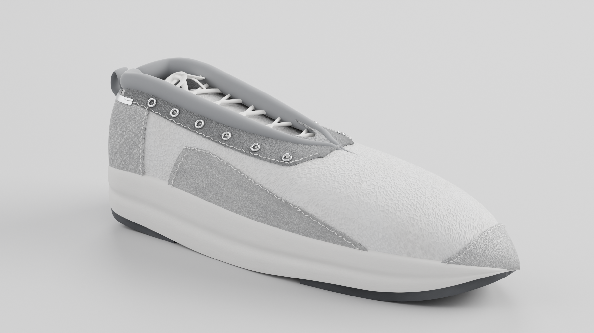
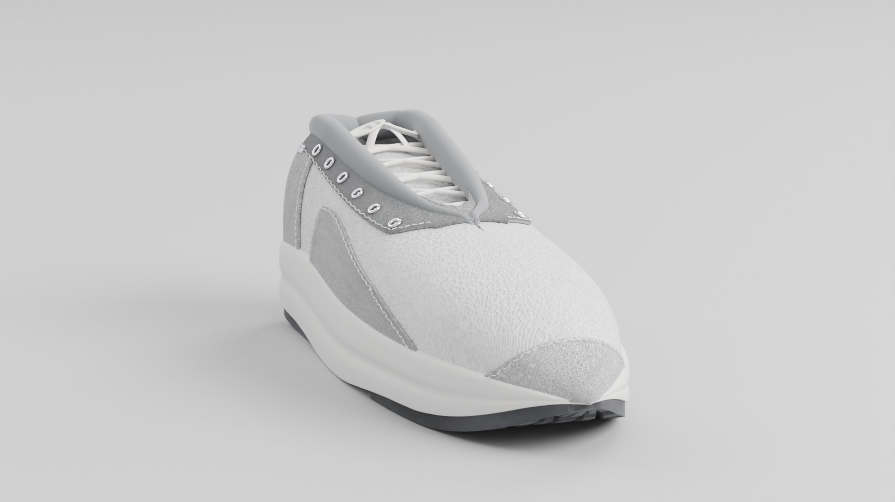
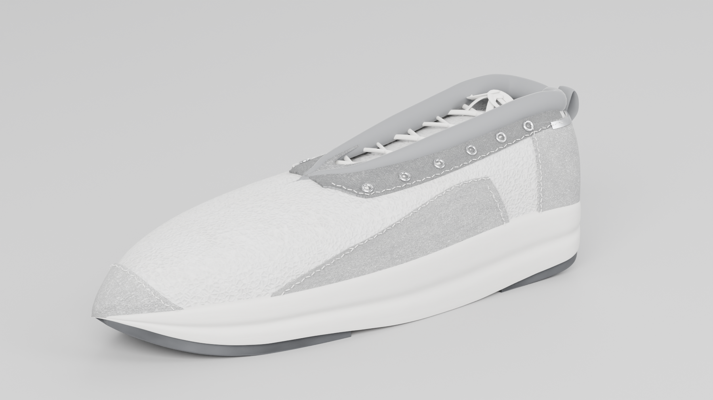
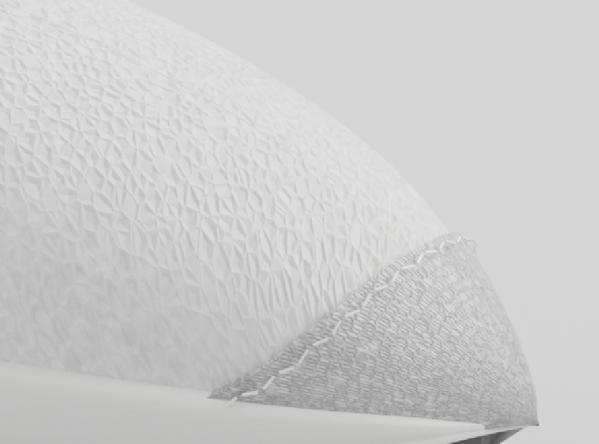
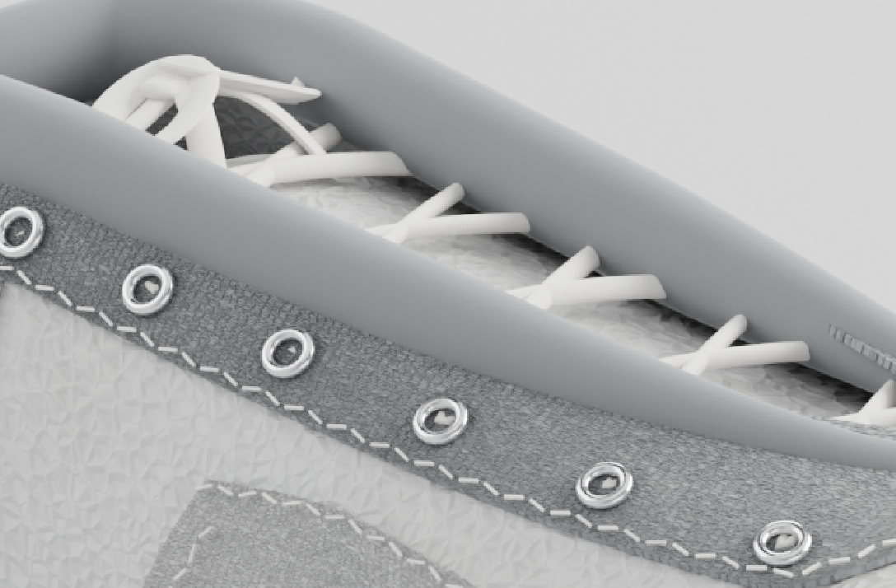
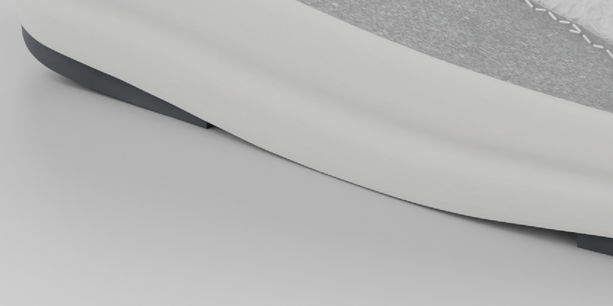
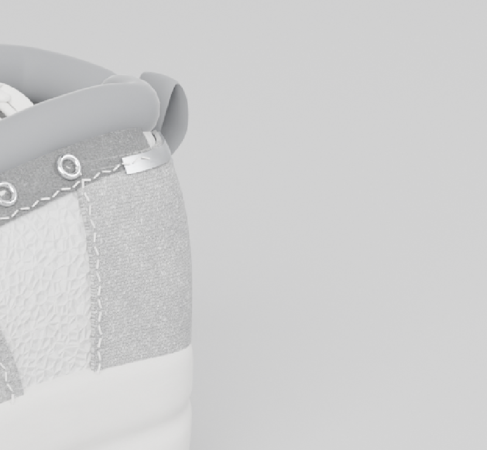

# Procedural Running Sneaker — Blender `bpy`

**A photorealistic studio product shot of a performance running sneaker that exists only as code.** No mesh files, no texture maps, no HDRI, no photo references: the geometry, materials, studio and lighting are all generated by Python running inside Blender, then rendered with Cycles.



<p align="center">
  <em>2400 × 1350 · Cycles (CUDA) · 160 spp · AgX — rendered from the script below</em>
</p>

---

## Highlights

- **Analytic footwear last** — the whole shoe is built from profile tables sampled on a parametric `(u, q)` surface: `u` runs toe pole → heel pole, `q` runs sole seam → crest. Every width is scaled by an elliptical pole factor, so all profiles collapse to single points at both ends (no pinching, no fan artefacts).
- **Layered construction** — knit shell with an analytic inner wall, then 1.3 mm-proud overlay panels (quarter, eyestay, heel counter, toe rand), each with its own bound edge and its own stitch line made of real dash geometry.
- **Distinct procedural PBR material per component** — engineered knit, dense-weave textile, closed-cell foam, rubber, soft metal, padded collar, braided lace, thread. Nothing shares a "one shader fits all" surface.
- **Everything texture-scaled in millimetres** — object-space/UV textures are driven by mesh UVs measured in mm (`Scale = 1 / feature_size_mm`), so the knit rib, weave and foam grain keep a constant real-world size across the model.
- **Studio built in-scene** — seamless light-grey cyclorama, soft key upper-front-left, restrained fill, subtle rim, background wash, world colour tuned for ambient occlusion in the seams.
- **Audited geometry** — purpose-written probe scripts check pole convergence, stray vertices, anomalous edge lengths, surface clearance, panel outlines and tongue/wall clearance before delivery.

## Gallery

| Front-low three-quarter | Medial three-quarter |
| --- | --- |
|  |  |

| Toe box & rand | Lacing, eyelets & bow |
| --- | --- |
|  |  |

| Sculpted midsole & outsole | Heel counter, pull tab & reflective trim |
| --- | --- |
|  |  |

Full-resolution stills and detail crops live in [`sneaker/renders/`](sneaker/renders); the scene file and glTF export live in [`sneaker/models/`](sneaker/models).

## The design

An original silhouette — no brands, logos or trademarks — in off-white, charcoal, cool grey with small reflective-silver accents.

| Component | Construction | Material |
| --- | --- | --- |
| Tapered toe box & vamp | shell lofted from profile tables, closed analytic inner wall (0.4–2.2 mm, tapering to zero at the poles) | engineered knit, off-white |
| Quarter panel, eyestay, heel counter | overlay panels 1.3 mm proud, 1.0 mm bound edge, hand-built bumper edges | dense-weave textile, cool grey |
| Toe bumper / rand | wrap panel with a tapered lip and a stitched boundary | dense textile, light grey |
| Midsole | sculpted foam loft: heel flare, toe taper, moulding crease along the sidewall | closed-cell foam, diffuse, off-white |
| Outsole | separate forefoot + heel pads with radial lugs | rubber, charcoal, high roughness |
| Collar | padded roll following the throat's opening curve, ends sunk into the shell | padded knit, cool grey |
| Tongue | lofted panel tucked behind the shell wall | knit |
| Laces | flat-ribbon tubes in a criss-cross, plus a tied bow (knot bar, loops, tails) | braided lace, off-white |
| Eyelets | 6 per side, evenly spaced | metal, silver |
| Reflective trim | strip along the heel counter's top edge | soft metal, silver |
| Stitching | real dash geometry (≈2.1 mm dashes, 0.3 mm thread) | thread |
| Heel pull tab | strap loop | dense textile |

## How it is built

```
sneaker/
├── shoe.py        # the shoe: profile tables, last, shell, overlays, sole, laces, stitching
├── shoelib.py     # table/PCHIP maths, mesh builder, tube(), solidify(), modifiers
├── materials.py   # procedural PBR node graphs (knit, weave, foam, rubber, metal, …)
├── studio.py      # cyclorama, lights, world, camera, render settings
├── main.py        # CLI: build → studio → render → save .blend → export .glb
├── probe*.py      # geometry audits (poles, strays, edges, panels, tongue clearance,
│                  #   tip macros, per-part identity-colour passes)
├── check_profile.py, measure.py, diag.py
├── crop.ps1       # PowerShell crop/zoom helper used while reviewing renders
└── RENDER_NOTES.md  # engineering notes for the delivery
```

1. **Tables → surface.** Continuous profile tables (`ZGB`, `ZST`, `ZRIM`, … widths) are interpolated with PCHIP and evaluated through an elliptical pole factor, giving a clean, closed last.
2. **Shell → wall.** The knit shell is lofted as a double grid: the outer surface, an inner surface offset along the analytic normal with a thickness profile that goes to zero at both poles, plus rim quads along the hem and collar. (Solidify was removed for this part — offsetting along degenerate pole normals produced fins.)
3. **Overlays.** Panels are generated as sub-grids of the same surface, pushed 1.3 mm outward, given a 1.0 mm bound edge, and stitched with dash geometry placed analytically inside each panel's outline.
4. **Materials.** Node graphs combine Gabor/wave/voronoi-based micro-structure for the knit, a tighter weave for the panels, soft noise for the foam, layered roughness breaks for the rubber, and restrained metallic highlights for the eyelets and trim. Base colours and roughness vary per component; nothing is a single-shader stand-in.
5. **Studio.** Cyclorama + six lights (key 820 W, fill, rim, top, front, background wash) and a cool-grey world; the camera is a 100 mm lens at a 3/4 angle slightly above the centreline, framed with negative space.
6. **Render.** Cycles on CUDA/OptiX, 2400 × 1350 at 160 spp with denoising, AgX view transform, exposure −3.7.

## Quick start

Requires Python 3.11 and Blender's `bpy` module wheel (CPU fallback works, GPU is much faster).

```powershell
git clone https://github.com/temidayoxyz/procedural-running-sneaker.git
cd procedural-running-sneaker

python -m venv .venv
.\.venv\Scripts\python.exe -m pip install -r requirements.txt

cd sneaker
# fast preview
.\.venv\Scripts\python.exe main.py -- --res 1100x620 --samples 72 --out preview.png

# final hero + scene + glTF export
.\.venv\Scripts\python.exe main.py -- --res 2400x1350 --samples 160 --lens 100 `
    --out hero.png --save-blend models\sneaker-studio.blend --glb models\sneaker.glb `
    --views "36,19,1.00,hero"
```

Useful flags: `--res WxH`, `--samples`, `--az/--el/--dist/--lens` (single view), `--views "az,el,dist,name;…"` (several views in one build), `--exposure`, `--cpu`, `--save-blend`, `--glb`.
Camera azimuth convention: `0°` = lateral (+X), `90°` = toe, `180°` = medial, `270°` = heel.

Rendering happens on a GTX 1050 Ti (4 GB) in this project — roughly 70–100 s to build the scene and ≈3.5 min for the 2400 × 1350 hero.

## Quality checks

| Script | What it verifies |
| --- | --- |
| `check_profile.py` | every profile table converges to a single point at both poles (spread 0.0000 mm) |
| `probe_spike.py` | no stray/duplicate vertices anywhere in the build |
| `probe_edges.py` | no anomalous edge lengths (catches fins, torn rims, bad welds) |
| `probe_crest.py` | nothing rides above the toe box's crest line except the rand's intended offset |
| `probe_panel.py` | overlay outlines are sane and their bottom edges hide behind the foam flare |
| `probe_tongue.py` | the tongue clears the shell wall and the liner (0 problems) |
| `probe_tip_multi.py`, `probe_tint.py` | tip macros and per-part identity-colour passes used to trace and fix the toe-pole fin |
| `measure.py`, `diag.py`, `probe*.py` | silhouette measurements, part bounds, per-view sanity renders |

The final hero's histogram was also measured: pixels at 255 occur only in ~0.002 % of the frame (tiny specular maxima on metal parts), i.e. no clipped areas on the shoe body.

## Deliverables

| Path | What |
| --- | --- |
| `sneaker/renders/hero-3q-lateral.png` | 2400 × 1350 hero still |
| `sneaker/renders/medial-3q.png`, `front-low.png` | 1800 × 1010 extra angles |
| `sneaker/renders/detail-*.png` | 2× detail crops of the delivered hero |
| `sneaker/models/sneaker-studio.blend` | full scene: shoe + cyclorama + lights + camera + render settings |
| `sneaker/models/sneaker.glb` | shoe only, glTF 2.0 binary (procedural node textures are not exported; base colours are) |
| `sneaker/RENDER_NOTES.md` | engineering notes: decisions, audits, accepted details |

## Notes & known limitations

- Panel edges are real cut edges (about 1 mm thick); at 3× zoom the bump-mapped edge reads slightly bound/scalloped. That is a deliberate look, not a tear.
- The interior is closed by a liner panel rather than an anatomically modelled footbed — it is never visible from any published angle.
- The midsole-to-upper transition is an intentional tangent discontinuity (two different materials meeting at a seam).
- The glTF export carries geometry and flat PBR values; the procedural micro-structure lives in the Blender scene, so the `.glb` looks simpler than the renders.
- Tread detail faces the ground and shows only from low/front angles by design.

## License

MIT — see [`LICENSE`](LICENSE).
